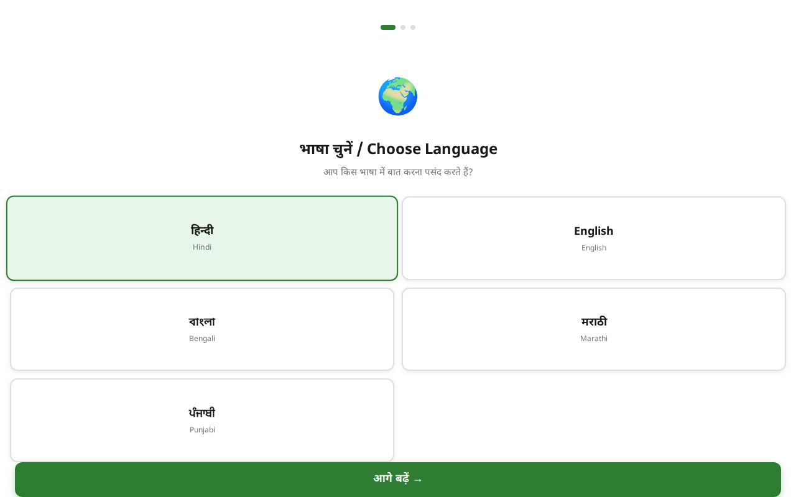
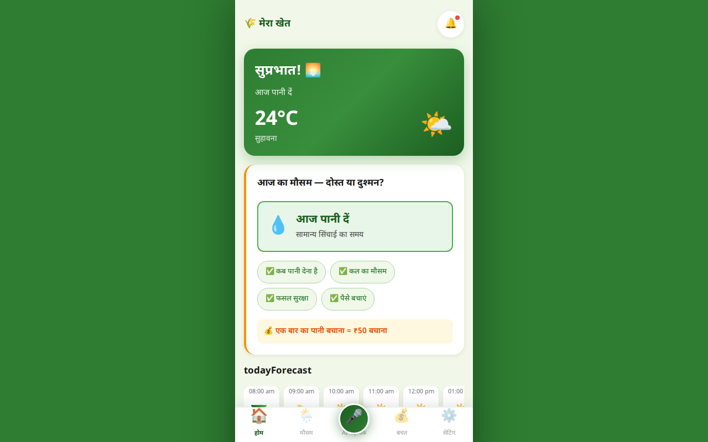

# Monsoon Mitra — a voice-first farming companion in 5 languages

**Live app: https://monsoonmitra.vercel.app** · Demo with sample data: https://monsoonmitra.vercel.app/?demo=true

This was the first app Abhishek built on his own laptop. When it was time to shoot the demo, his father woke before dawn and went with him into the rice fields to film it. That is the user this app is built for.

A farmer speaks instead of typing. Will it rain tomorrow? Should I water today? Is my crop in danger? Monsoon Mitra answers by voice, in the farmer's own language, on a low-cost Android phone.

## Screenshots





## The problem

Every monsoon morning, a small farmer has to decide: water the crop today, or wait for rain? One mistimed irrigation cycle wastes ₹450–₹750 and thousands of litres of water, and the monsoons farmers once read from experience have become hard to predict. The government apps that exist are slow, English-heavy, and ask a farmer to type and read — in the middle of a working day, with wet hands, in the field.

## Who it is for, and who would pay

For India's small and marginal farmers — about 140 million of them, farming an average of 1.15 hectares, most on phones that cost under ₹8,000. The app is free for the farmer, with no registration and no personal data collected.

The paying side is the organisations that need to reach those farmers: farmer producer organisations (FPOs), agri-input companies, and state programmes that run advisories for thousands of farmers at a time, in the language each farmer actually speaks.

## What works today

- **Ask by voice or text, in 5 languages.** Hindi, Bengali, Marathi, Punjabi and English. One big mic button in the centre; speak a question, hear the answer. Farming questions are answered by Google Gemini 1.5 Flash, called through a server-side proxy so the key never reaches the phone.
- **A clear answer on watering, every day.** The irrigation advisor weighs the real 7-day forecast for the farmer's exact location (Open-Meteo, free, no account) and says plainly: water today, or don't — rain is coming. Skipping one needless cycle saves roughly ₹450–₹750.
- **Hyperlocal weather.** A 7-day forecast with rain-probability bars for the farmer's own spot, not the district average.
- **Flood and drought alerts.** Warnings are pushed before danger arrives (Firebase Cloud Messaging), so there is time to act.
- **A savings tracker.** Water and money saved by following the advice, counted in rupees the farmer can see adding up.
- **Works offline.** The important information stays available with no internet, because that is what the field is like. The demo mode fills the app with 15 days of sample farmer data — savings counter, irrigation log, live weather — so anyone can see it working in one click.
- **Light enough for the phone it runs on.** About 35 KB of JavaScript (gzipped); it loads in under 2 seconds on 4G.

## The numbers

- 5 languages, spoken and written
- 21 automated tests, all passing, with CI on every push
- ₹450–₹750 saved per irrigation cycle the app says to skip
- 0 sign-ups, 0 personal data collected — nothing about the farmer leaves the device except the question asked

## How it is built

| Layer | Technology |
|---|---|
| Frontend | React 18 + Vite 5, Tailwind CSS 3 — a Progressive Web App |
| AI answers | Google Gemini 1.5 Flash, via a Vercel serverless proxy at `/api/chat` |
| Weather | Open-Meteo API (free, no key) |
| Alerts and analytics | Firebase Cloud Messaging and Firebase Analytics (anonymous) |
| Hosting | Vercel |
| Testing | Vitest + MSW, 21 tests; GitHub Actions CI |

Safety basics are in place: the Gemini key is server-side only, requests are rate-limited to 10 per minute per IP, input is cleaned and capped at 800 characters, and the app sets CSP and HSTS headers.

## Run it

```bash
git clone https://github.com/MSAbhishek22/monsoon-mitra.git
cd monsoon-mitra
npm install
cp .env.example .env.local   # add your API keys
npm run dev                  # http://localhost:5173
```

```bash
npm run test:run        # 21 tests across 6 test files
npm run build           # production build check
```

See `PLAY_STORE_LISTING.md` for the store listing draft.

## Where this can go

- Crop disease checks from a phone photo, so a farmer can ask about a sick plant the same way he asks about rain.
- Market prices (e-NAM) and a PM-KISAN scheme helper, in the same voice, in the same app.
- Working with FPOs district by district, so the advice and alerts reach whole farming communities at once.

## One line on a neighbouring project

JalRaksha, built for the Xylem challenge, watches village drinking-water points — which handpump works, which water is safe. Monsoon Mitra is a different job: rain, irrigation and crop risk, for the farmer himself.

## Team

Built with equal contribution by:

**M S Abhishek**
msabhishekanni10@gmail.com · [github.com/MSAbhishek22](https://github.com/MSAbhishek22)

**Aayushi Goel**
aayushigoel73@gmail.com

## License

MIT License — free to use, fork, and build upon.
